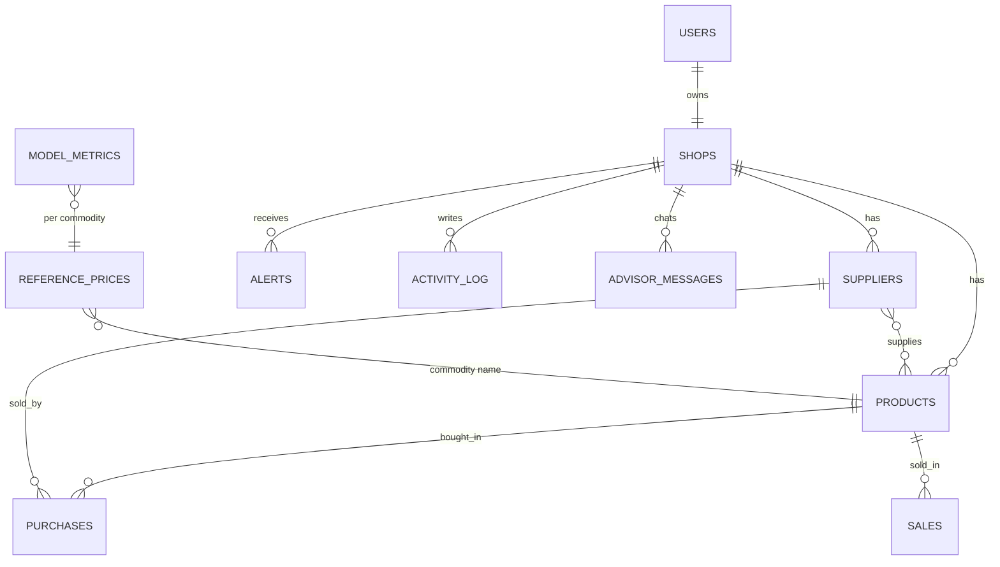

# VyapariAI: an AI-powered price and purchase advisor for local shopkeepers

Project report - Ramdeobaba University, Computer Science Engineering, IDEA Lab, 2024-28 (5th semester). Generated 2026-10-09.
Team: Madhulika Deshpande (A7_B3_34), Sharvari Mainde (A7_B4_55), Oshin Dhabale (A7_B1_09). Guide: Prof. Poonam Meghare.

## Abstract
Local shopkeepers decide purchase prices, quantities and selling prices mostly from experience, so they often overpay suppliers, hold too much or too little stock and lose margin.
VyapariAI is a web application that records a shop's products, suppliers, purchases and sales and compares purchase prices with reference market prices. It forecasts the market price of a
commodity for 7 to 14 days, detects abnormal purchase prices with an ensemble of three methods, recommends Buy Now, Buy Limited Quantity or Wait with a quantity, suggests a selling price range and
compares suppliers. A retrieval-augmented advisor built on the Gemini API explains the results in English, Hindi and Marathi, by text or voice, using only the shop's own numbers; a numeric
check blocks invented prices. On our data, the best forecasting model per commodity reached a mean MAPE of 0.72 % (7 days ahead) and beat the naive baseline on 15 of 15
commodities; the anomaly ensemble reached F1 0.96 and 0.98 on two labelled test sets. Market prices and shop data are partly synthetic, so these
results demonstrate the method, not real-world accuracy.

## 1. Introduction
### 1.1 Problem
A shopkeeper rarely knows whether a supplier's price is fair, whether prices will rise or fall, how much to buy and when, which supplier is better value, or what selling price gives a reasonable profit. [TODO: add one real example from a shop you visited.]
### 1.2 Objectives (from the synopsis) and where they are met
| Objective | Delivered by |
|---|---|
| Capture product, supplier, purchase, sales and stock data | Products, Suppliers, Purchases, Sales, Inventory pages, CSV import |
| Fair-price analysis against reference prices | `services/fair_price.py`, Pricing page |
| ML price prediction and anomaly detection | `ml/train_forecast.py`, `ml/anomaly.py` |
| Purchase decision engine with quantity | `services/decision_engine.py` |
| Selling-price range balancing cost, margin and market | `services/pricing_engine.py` |
| RAG-based AI Business Advisor | `services/advisor/*` |
| Simplified supplier comparison (post-MVP) | `services/supplier_stats.py` |
### 1.3 Scope
In scope: the core MVP above and simplified supplier comparison. Out of scope (as in the synopsis): supplier reliability ranking, app-wide voice/multilingual UI, WhatsApp alerts, mobile app, invoice scanning, real-time market APIs, advanced demand forecasting, supplier marketplace.

## 2. Literature review and research gap
Retail and commodity price forecasting has used regression, Random Forest, XGBoost and time-series models [1], [2]. Isolation Forest and statistical thresholds are standard for anomaly detection in retail and financial data [3], [4].
Retrieval-augmented generation grounds language-model output in verified data [5]. Existing systems target large supply chains with large, clean datasets and rarely combine price prediction, anomaly detection, purchase decisions and a grounded conversational advisor for one small shop.
**Research gap:** no lightweight system integrates these for an individual hyperlocal shopkeeper. VyapariAI is such a system; its design choice is that retrieval is **structured** (SQL/Pandas services) instead of vector search, because the shop's data is numeric tables.

## 3. System design
### 3.1 Architecture
Browser (React) -> JSON API with login token (FastAPI) -> services (fair price, anomaly, decision, pricing, supplier statistics) -> database (SQLite in development, PostgreSQL in deployment) and joblib model files; the advisor calls the Gemini API with a compact context, or answers from offline templates. [FIGURE: architecture diagram from README.md]
### 3.2 Database design

Every table that belongs to a shop has `shop_id` and every query filters by the logged-in user's shop. `reference_prices` and `model_metrics` are public, shared data. Prices are rupees per unit; dates are ISO dates.
### 3.3 API
53 operations in 17 groups, 3 of them public (signup, login, health); all others need a login token. Full list: `docs/api_overview.md`.
### 3.4 Main user flows
Sign up -> shop setup -> add products and suppliers -> record purchases (live fair-price tag, instant abnormal-price warning) and sales -> read dashboard, recommendations and forecasts -> ask the advisor.

## 4. Data
| Source | Used for | Real or synthetic |
|---|---|---|
| India Wholesale Price Index, 2011-12 base (Apr 2011 - May 2017) | Shape of market price movement for 14 commodities | Real index; converted to rupees with **assumed** anchor prices; dates shifted forward |
| Seeded generator (trend, yearly wave, weekly wobble, shocks) | Paneer, and the gap up to today | **Synthetic** |
| UCI wholesale customers and Online Retail datasets | Category spend shares, demand noise, monthly index (statistics only) | Real statistics, used loosely |
| Demo shop (`seed_demo.py`, fixed seed) | 12 months of purchases and sales, 25 injected anomalies | **Synthetic** |
Cleaning: dates parsed, thousands separators removed, duplicates dropped, typo outliers (more than 3x the neighbouring median) removed, gaps filled (at most one month by interpolation, 3 days forward-fill), commodities with under 12 months dropped.
**Honest limitation:** the WPI is an index, not a price. The real information is the movement, not the level.

## 5. Methodology
### 5.1 Business rules (all in one file, `services/config.py`)
| Rule | Value (services/config.py) |
|---|---|
| Fair price: Great deal | variance <= -3 % |
| Fair price: Fair | -3 % < variance <= 3 % |
| Fair price: Slightly high | 3 % < variance <= 8 % |
| Fair price: Overpaying | variance > 8 % |
| Reference price age limit | 7 days |
| Forecast Rising / Falling | 7-day change >= 3 % / <= -3 % |
| Forecast confidence band | 1.28 standard deviations (80 %) |
| Anomaly: strong deviation flags alone | > 25 % from market |
| Anomaly severity high / medium | > 30 % / > 20 % |
| Isolation Forest contamination | 0.05 |
| Overpaying supplier alert | last 3 purchases all > 8 % above market |
| Decision: strong rise | >= 6 % forecast rise -> buy x1.2 |
| Decision: Buy Limited quantity | 50 % of the shortfall |
| Decision: wait while price falls | stock lasts lead time + 2 days |
| Decision confidence High / Medium | MAPE < 3 % / < 6 % |
| Selling price range | 0.97 x to 1.05 x the recommended price |
| Price vs market warning | more than 8 % away |
| Cost basis | weighted average of the last 5 purchases |
### 5.2 Fair-price analysis
variance % = (price paid - market price) / market price x 100, rounded to one decimal so the number the shopkeeper sees always agrees with the verdict. The market price is the latest reference price on or before the purchase date, at most 7 days old. Potential savings = sum over purchases above market of (price - market) x quantity.
### 5.3 Price forecasting
Features (14, all from past data only): lags 1, 7, 14, 28; rolling mean over 7, 14, 30 days; rolling standard deviation over 7, 14 days; percent change over a week; day of week; month; sine and cosine of day of year. Leakage is prevented by shifting the series by one day before every rolling window (a unit test proves this).
Models: naive, Linear Regression, Random Forest (300 trees), XGBoost (400 shallow trees), Holt-Winters. Tree models predict the percent change from yesterday (they cannot output prices above what they saw), then convert back. Evaluation is chronological (last max(60 days, 20 %) is the test period) with a rolling origin: every 7 days the model forecasts the next 7 days using only earlier data. Metrics: MAPE and RMSE. The lowest MAPE wins and is saved.
### 5.4 Anomaly detection
Three detectors vote: Z-score against the product's last 90 days, Isolation Forest (contamination 0.05), and a threshold rule against the market price. A purchase is flagged when two agree or when it is more than 25 % off the market. Severity: high above 30 %, medium above 20 %. Z-score cutoff and threshold come from the shop's settings.
### 5.5 Decision engine
Derived: days left = stock / average daily sales; need during delivery = daily sales x lead time; target = daily sales x cover days; shortfall = target - stock. Rules, first match wins: (1) stock <= need during delivery -> Buy Now (Buy Limited if the price is bad); (2) forecast Rising and low stock -> Buy Now (x1.2 when the rise is strong); (3) forecast Falling and enough stock -> Wait; (4) bad price -> Buy Limited; (5) enough stock -> Wait; (6) otherwise Buy Limited. Without sales history the reorder level replaces sales speed and a note says so.
### 5.6 Selling-price engine
cost = weighted average of the last 5 purchases; floor = cost x (1 + minimum margin); target = cost x (1 + target margin); recommended = market retail price clamped between floor and target; range = 0.97 x to 1.05 x recommended, never below the floor.
### 5.7 Supplier comparison
Per supplier and product: average, minimum, maximum, latest price, coefficient of variation (stable below 3 %, moderate to 7 %, volatile above) and average difference from market. Best value = lowest average among suppliers with at least 3 orders that are not volatile. No combined reliability score is shown.
### 5.8 The AI advisor (RAG)
Pipeline: guards (500 characters, 20 questions per minute, medical/legal refusal) -> understand (product and topic detection in English, Hindi, Marathi) -> retrieve (structured services, cached 60 s) -> augment (rules + compact JSON context under about 3000 tokens) -> generate (Gemini, temperature 0.2, 20 s timeout, one retry) -> check (every price in the answer must exist in the context within 1 %; one stricter retry; otherwise the offline answer) -> explain (sources shown). If Gemini is unavailable a template answer with the same numbers is returned.

## 6. Implementation
React 19 + Vite + Tailwind + recharts; FastAPI + SQLAlchemy 2.0 + Pydantic v2; JWT login; scikit-learn, XGBoost, statsmodels; google-genai. Security: bcrypt passwords, signed tokens, every query filtered by shop, parameterised SQL, CORS allow-list, production start-up checks. Quality: 450 automated tests (SQLite) of which 442 also pass on PostgreSQL, a 22-step end-to-end script and a 23-check browser-style smoke test.

## 7. Results and evaluation
### 7.1 Forecasting (15 commodities, 7 days ahead)
| Model | Average MAPE % | Average RMSE (Rs) |
|---|---|---|
| Naive | 1.01 | 1.08 |
| Linear Regression | 0.80 | 0.86 |
| Random Forest | 1.10 | 1.19 |
| XGBoost | 1.31 | 1.44 |
| Holt-Winters | 0.73 | 0.84 |

Wins by model: Linear Regression 2, Random Forest 1, Holt-Winters 12. The selected model beat the naive baseline on **15 of 15** commodities; mean MAPE of the selected models **0.72 %**. [FIGURE: docs/figures/forecast_mape_by_model.png and forecast_actual_vs_pred_rice.png]
**Discussion.** The synopsis expected XGBoost to be the best model. On our data it is the **worst** on average (MAPE 1.31 %), while the classical time-series model Holt-Winters is best (0.73 %) and the naive baseline scores 1.01 %.
The reason is the data: the price series are smooth and seasonal with small random noise, which suits exponential smoothing; tree models need more varied data and cannot extrapolate. The margin between models is small (a few tenths of a percentage point). On real, shock-driven mandi prices the ranking may change, so the system keeps all five models and picks per commodity.
### 7.2 Anomaly detection (default settings)
| Test set | Method | Precision | Recall | F1 |
|---|---|---|---|---|
| ground_truth | Z-score | 0.48 | 0.64 | 0.55 |
| ground_truth | Isolation Forest | 0.73 | 0.88 | 0.80 |
| ground_truth | Threshold rule | 1.00 | 1.00 | 1.00 |
| ground_truth | Ensemble | 0.96 | 0.96 | 0.96 |
| fresh_injection | Z-score | 0.50 | 0.76 | 0.60 |
| fresh_injection | Isolation Forest | 0.70 | 0.84 | 0.76 |
| fresh_injection | Threshold rule | 1.00 | 0.96 | 0.98 |
| fresh_injection | Ensemble | 1.00 | 0.96 | 0.98 |

Grid search over 27 settings: best average ensemble F1 0.980 (`z=3.0, thr=10%, cont=0.08`). [FIGURE: docs/figures/anomaly_metrics_by_method.png]
**Discussion.** The simple threshold rule scores F1 1.00 on the labelled set because every injected anomaly is 20-45 % away from the market while normal prices stay within about 8 %. The ensemble is close (0.96) but not better here.
Its value is robustness: it still works when no market price is known (the threshold rule falls back to recent prices) and it needs agreement before alarming. On real data with smaller differences the threshold rule alone would produce more false alarms.
### 7.3 Advisor
20-question evaluation in `docs/eval/advisor_tests.md` (13 core questions in three languages plus 7 edge cases: unknown product, next year, medical, data not available, Hinglish, a 600-character question, a prompt-injection attempt). [TODO: after running with your Gemini key, fill the "Action correct" and "Language OK" columns and write: X of 20 correct, Y of 20 grounded, Z language problems.]
### 7.4 Performance
See `docs/eval/performance.md` (end-to-end script timings; most reads under 150 ms; the first recommendations call after a restart loads the saved models).

## 8. Discussion and limitations
1. Market prices are partly synthetic and the WPI level is assumed; accuracy on real prices must be re-measured. 2. The demo shop is synthetic. 3. Forecasts cover 7-14 days only and cannot anticipate shocks. 4. Anomaly results use injected anomalies. 5. In-memory caches, rate limiting and retrain status work for one server process. 6. Voice input needs Chrome or Edge; Hindi/Marathi read-aloud needs an installed voice. 7. Model changes need a new database (no migrations). 8. The advisor was tested with a mocked model in the automated tests; its real-model quality is shown only by the manual evaluation sheet.

## 9. Conclusion and future work
VyapariAI delivers the synopsis's core MVP and the simplified supplier comparison as a working, tested application. The main finding is that simple, well-evaluated methods (Holt-Winters, a threshold rule) are hard to beat on smooth data, which is why the system compares models instead of assuming one.
Future work: real mandi price feeds (Agmarknet), demand forecasting, reliability scoring of suppliers, WhatsApp alerts, a mobile app, invoice scanning, database migrations, a shared cache (Redis), and user studies with real shopkeepers. [TODO: add what you would do first.]

## References
[1] A. Balusani, P. J. R. Chowdary, and B. V. N. P. Paruchuri, "Enhancing Retail Demand Forecasting with XGBoost: A Comparative Study with Machine Learning and Deep Learning Models," SSRN Electronic Journal, 2025.
[2] D. R. Lestari, E. A. S. Bangun, F. L. Gaol, and T. Matsuo, "Machine Learning-Based Forecasting of Agricultural Commodity Prices Using Ensemble Models," Journal of Human, Earth, and Future, vol. 6, no. 4, pp. 887-899, 2025.
[3] S. Ounacer, H. A. El Ghali, S. Ardchir, M. Daif, and M. Azouazi, "Using Isolation Forest in Anomaly Detection: The Case of Credit Card Transactions," Periodicals of Engineering and Natural Sciences, 2018.
[4] S. C. Konidina, "Detecting Retail Sales Anomalies with Isolation Forest - A Practical PoC," Medium, 2025.
[5] P. Lewis et al., "Retrieval-Augmented Generation for Knowledge-Intensive NLP Tasks," in Proc. NeurIPS, vol. 33, 2020, pp. 9459-9474.
[6] Kaggle. [Online]. Available: https://www.kaggle.com
